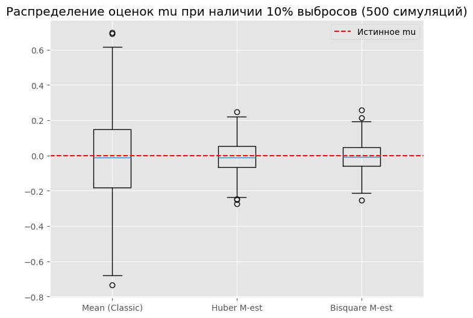
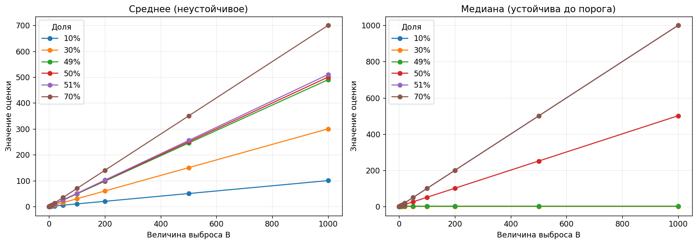
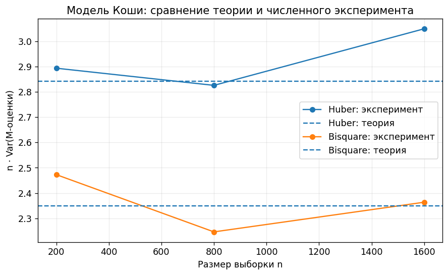

# Робастная статистика: устойчивые оценки и влияние выбросов

Вычислительный проект о том, как выбросы и тяжёлые хвосты влияют на статистические оценки. На смоделированных данных сравниваются классические оценки и робастные методы: медиана, оценки Huber и Tukey bisquare.


## Что исследовано

- Оценки положения и масштаба при загрязнении нормальной модели.
- Функции влияния и чувствительность оценок к отдельным наблюдениям.
- Breakdown point медианы и качество оценок при росте доли загрязнения.
- M-оценки при неизвестном масштабе и настройка эффективности.
- Поведение робастных оценок на распределении Коши.

## Основные результаты

- В смеси с 10% выбросов эмпирический разброс оценок Huber и Tukey bisquare оказался существенно ниже, чем у среднего; среди этих методов на данной симуляции наименьшая дисперсия была у bisquare.
- Медиана сохраняла ограниченность при доле загрязнения ниже 50%, тогда как среднее быстро смещалось с ростом величины выброса.
- Для Huber и bisquare наблюдалась конечная асимптотическая дисперсия на распределении Коши, в отличие от классического среднего.

## Графики

### Сравнение оценок в симуляции с выбросами

500 независимых выборок, 10% загрязнения. Робастные оценки дают более узкое распределение вокруг истинного центра в этом эксперименте.



### Устойчивость медианы при росте выброса

При доле замен ниже 50% медиана остаётся ограниченной при увеличении величины выброса. При достижении порога её оценка также становится неограниченной.



### Робастные оценки на распределении Коши

Сопоставление теоретической асимптотической дисперсии и симуляционных оценок при разных размерах выборки.



## Структура

| Файл | Содержание |
| --- | --- |
| `robust_stat_1.ipynb` | Оценки положения и масштаба, загрязнённая нормальная смесь, совместное оценивание и сравнение Монте-Карло |
| `robust_stat_2.ipynb` | Функции влияния, breakdown point, M-оценки при неизвестном масштабе и распределение Коши |

## Запуск

Установите зависимости и откройте ноутбуки в Jupyter:

```bash
pip install numpy pandas scipy matplotlib jupyter
jupyter lab
```

## Ограничения

Результаты относятся к моделям и параметрам, заданным в ноутбуках, и не являются проверкой на реальных прикладных данных. В частности, максимальное смещение во втором ноутбуке оценивается на конечной сетке загрязнений, поэтому не интерпретируется как строгий глобальный супремум.
